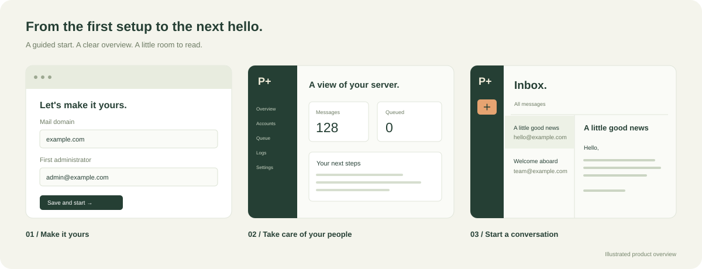

<p align="center">
  
</p>

<p align="center">
  A mail server with browser-based setup, a dedicated administration panel, and Webmail.<br>
  Create accounts, send and receive mail, and manage your server in one place.
</p>

<p align="center">
  <a href="docs/getting-started.md">Getting started</a> ·
  <a href="docs/getting-started.zh-CN.md">中文入门指南</a> ·
  <a href="docs/configuration.md">Configuration reference</a> ·
  <a href="docs/protocols.md">Protocol support</a>
</p>

## A home for your email

- **Start in your browser.** Run PostPlus, open the setup address printed in the terminal, and create your first administrator.
- **Keep administration separate.** Manage accounts, inspect a user’s mail without changing its read status, set individual storage quotas, and review queues and logs. Webmail runs on its own port.
- **Give every message a place.** Use Inbox, Sent, Drafts, Trash, Junk, and Archive. Save a draft, resume writing later, and move messages between folders.
- **Write and find mail.** Compose formatted messages with attachments, CC and BCC, reply or forward, and search decoded mail across folders with date, sender and attachment filters.
- **Follow delivery.** View per-recipient delivery history and retry details from Sent mail. Incoming spam goes to Junk with a visible score and reasons; optional local Rspamd adds a maintained spam engine.
- **Set up encrypted connections.** Request a Let’s Encrypt certificate through the browser, or use certificates you already have.
- **Make it comfortable.** Switch between English and Simplified Chinese, choose light or dark mode, or follow your device's appearance. Adjust reading preferences and use the same tools on your phone.
- **Connect mail clients.** Send through SMTP and read through POP3 or the supported IMAP commands, with TLS support.
- **Keep mail on disk.** Accounts, mailboxes, delivery queues, and retries survive restarts. Rejected mail is retained in quarantine.
- **Choose who has an account.** Administrators create users or issue expiring invitation links for ordinary mailbox registration.
- **Find recent verification codes and links.** Webmail recognizes codes and account verification links from recent Inbox or Trash mail without marking it read. Copy a code or inspect a link's destination before opening it; integrations can use the owner-bound API.
- **Host many independent mail domains.** Add domains through a DNS verification wizard, find them in a searchable, paginated list, and keep each full mailbox address independent. Administration has one designated hostname; Webmail uses each mailbox domain, with an optional shared login hostname.
- **Route mailbox prefixes.** Wildcard forwarding sends matching local addresses to an existing local inbox.
- **Limit integration access.** Choose API key permissions independently for administration and personal mailbox APIs. See [mailbox features and permissions](docs/access.md).

<p align="center">
  
</p>

PostPlus is under active development. It supports local mail, built-in direct MX delivery with DKIM signing, and optional SMTP relays. See [Current scope](#current-scope) before planning an internet-facing installation.

## Quick start

Download a package for your platform from [Releases](https://github.com/TabNahida/PostPlus/releases), extract it, and open a terminal in the extracted directory:

```sh
# Linux or macOS
./postplus
```

```powershell
# Windows PowerShell
.\postplus.exe
```

Keep the executables and `web` folder together. No compiler, Python, or Node.js is needed to run a binary release. See [binary releases](docs/releases.md) for platform requirements and checksum verification.

### Build from source

Install [xmake](https://xmake.io/) 2.9.8 or newer and a C++20 compiler. Windows users need Visual Studio 2022's **Desktop development with C++** workload; Linux users can use GCC 12 or newer; macOS users need current Xcode Command Line Tools.

From the repository root:

```sh
xmake f -m release -y
xmake build -y
xmake run postplus
```

On an unconfigured installation, an interactive terminal lets you choose `127.0.0.1` for local setup or `0.0.0.0` for remote setup. Remote setup asks for the server hostname or IP used by your browser. Without an interactive terminal, setup defaults to loopback; pass `--setup-bind` explicitly to select another address. The terminal then tells you that setup is required and prints:

- The **setup address**, normally `http://127.0.0.1:8081/`.
- A random **one-time setup password**, used to unlock the setup page.

Open that address, enter the setup password, then choose your domain and create a permanent administrator password. For direct remote setup without an existing certificate, run `./postplus --setup-bind 0.0.0.0 --setup-host SERVER-IP`. For a first local trial, keep the loopback addresses and select local development mode. Save the form to start the services.

| Interface | Local development default |
| --- | --- |
| Administration | `http://127.0.0.1:8081/` |
| Webmail | `http://127.0.0.1:80/` |

Sign in to administration to create users and adjust settings. Sign in to Webmail to read or compose mail. **Ctrl+C** stops the whole service group; the same launch command loads your saved installation next time. TLS-enabled installations use HTTPS.

For remote servers, domain and certificate setup, relay delivery, account creation, and troubleshooting, follow the **[step-by-step guide](docs/getting-started.md)** or **[中文入门指南](docs/getting-started.zh-CN.md)**.

### Run an existing installation

```sh
xmake run postplus --config "config/postplus.json"
xmake run postplus --help
```

The default configuration is `config/postplus.json`. An existing sample with no configured service-token source and no completed-setup marker enters setup; an established configuration starts its saved services. Invalid or unreadable configurations are reported rather than silently discarded.

The native launcher starts and monitors all service processes. A standalone installation keeps `postplus`, all `postplus-*` service executables, and the bundled `web` directory together. Build output is under `build/<platform>/<arch>/<mode>/`. `xmake run` uses the repository root and refreshes the web bundle. Python is needed only for integration tests, not to start the server.

## Configure and operate

Storage-size fields offer byte, KiB, MiB, GiB, and TiB selectors while configuration files retain exact integer byte values. Per-user quotas in **User accounts → Storage quota** take effect immediately; global settings automatically restart the affected services when the native supervisor is running.

Open **Settings** near your account for language and appearance preferences. **User accounts → Account password policy** controls new accounts and password resets, with an eight-character default minimum and optional character requirements. Changes take effect immediately; existing passwords and saved policies continue to work. Setup, account creation, administration login, and Webmail login fill in `@domain` automatically; enter the mailbox name before it.

Most day-to-day options are available in **Administration → Server settings**: listener addresses and ports, TLS, relay delivery, filtering, resource limits, sessions, and logging. Saving validates the configuration, creates a backup, and automatically restarts only affected services through the native supervisor. The page shows restart progress and updated addresses. Your administration session remains available unless the administration service restarts; use the new address and sign in again in that case. Independently launched services require a manual restart.

Use **Apply standard ports** to replace old saved port values, and **Mail clients** for encrypted SMTP/IMAP/POP parameters and DNS discovery records. **Update PostPlus** downloads verified changed modules from the latest stable Release, retains configuration and data, and restarts affected services. See [mail client settings](docs/mail-clients.md) and [the upgrade guide](docs/updates.md).

**Server settings → Server maintenance** lets you download a data backup, restart all services with the saved configuration, or save the current server settings and shut down. The full-restart action automatically brings PostPlus back, including installations made with the supplied systemd script; shutdown leaves it stopped. Backups include accounts, mail, queues, configuration, and configured credentials; store them privately. The terminal reports shutdown progress for both the web action and **Ctrl+C**. See [backup, restore, and shutdown](docs/maintenance.md) for recovery instructions.

- [Getting started](docs/getting-started.md) — from first launch to your first message.
- [中文入门指南](docs/getting-started.zh-CN.md) — 本地试用、域名与 TLS、后台设置和常见问题。
- [Configuration reference](docs/configuration.md) — field names, defaults, examples, secrets, and manual editing.
- [Architecture and operations](docs/architecture.md) — process lifecycle, delivery, logging, and backups.
- [HTTP API](docs/api.md) — sessions, Webmail, administration, settings, and setup.

The [example configuration](config/postplus.example.json) is a reference for manual management. The browser wizard generates a private service credential automatically. Mail data stays in the installation's data directory; changing that directory later requires a deliberate offline migration.

For external recipients, select built-in direct delivery and publish the generated DKIM/SPF records, or configure an SMTP relay. Direct sending requires outbound TCP 25, public DNS and suitable PTR/IP reputation. Full antivirus scanning requires a separately installed and maintained ClamAV service. PostPlus can request Let’s Encrypt certificates using HTTP-01. Automatic certificate renewal is not implemented.

## Architecture and development

PostPlus uses **C++20**, **standalone Asio**, **OpenSSL 3**, **SQLite**, and **xmake**. Authentication and storage each own their SQLite database. Other services use authenticated loopback RPC instead of accessing those databases directly.

| Executable | Responsibility | Default listener |
| --- | --- | --- |
| `postplus` | Setup and service supervision | Setup: loopback 8081 |
| `postplus-admin` | Administration, accounts, settings, queue and logs API | Loopback 8081 |
| `postplus-web` | Webmail and mailbox API | Loopback 80 |
| `postplus-smtp` | ESMTP reception and authenticated submission | Loopback 25 |
| `postplus-pop3` | POP3 mailbox access | Loopback 110 |
| `postplus-imap` | IMAP mailbox access | Loopback 143 |
| `postplus-auth` | Accounts, password verification, administrator roles | Loopback 18081 |
| `postplus-storage` | Mailboxes, persistent UIDs, MIME, delivery queue | Loopback 18082 |
| `postplus-filter` | MIME inspection, spam rules, EICAR detection, ClamAV client | Loopback 18083 |
| `postplus-transfer` | Outbound SMTP through direct MX delivery or a configured relay | Loopback 18084 |
| `postplus-delivery` | Queue processing, retries, local delivery, quarantine | Loopback 18085, instance lock only |
| `postplus-ctl` | Command-line administration | None |
| `postplus-clean-data` | Offline reset of accounts, mail, and queues, with a dry-run option | None |
| `postplus-update` | Verified module installation and launcher recovery | None |

### Build and test

```sh
xmake f -m debug -y
xmake build -y
xmake test -v
node tests/web_test.js
node tests/preferences_ui_test.js
python tests/integration.py --build-dir build --mode debug
```

xmake installs pinned dependencies. Web checks require Node.js 22 or newer; integration tests require Python 3.12 or newer. Tests use isolated data directories, local accounts and ports, and a simulated relay. They do not send public email. Diagnostics are written under `build/test-runs/`.

[GitHub Actions](.github/workflows/ci.yml) builds and tests Linux, Windows, and macOS in Debug and Release. The source layout is:

```text
include/postplus/       Shared networking, MIME, setup, and process interfaces
src/core/              Networking, TLS, HTTP, logging, MIME, setup, configuration
src/services/          Independent service entry points
src/tools/             Native launcher and administration CLI
config/                Example configuration
web/                   Webmail, administration, setup, icons, and translations
docs/                  Guides, references, and architecture
tests/                 C++ tests, web checks, and integration suites
.github/workflows/     Cross-platform CI
```

## Current scope

- IMAP supports [documented mailbox workflows](docs/protocols.md), including persistent custom folders, subscriptions and flags, IDLE synchronization, ENVELOPE, BODYSTRUCTURE, MIME sections, APPEND, COPY and MOVE. IMAP/POP3 accept TLS password authentication with PLAIN/LOGIN; POP3 download transactions hold an exclusive maildrop lease.
- Webmail reads plain text, isolated HTML, and attached forwarded messages across built-in and client-created folders. It composes plain or formatted messages, supports attachments, CC/BCC, replies, forwarding, saved drafts, search and per-recipient delivery history. Remote images load automatically in the isolated reader. Custom folder creation remains available through IMAP. A Sent copy records queue submission; remote server acceptance does not confirm inbox placement or reading.
- Incoming spam is scored locally and placed in Junk; optional loopback Rspamd can supply additional verdicts. Webmail can move messages to Junk or restore them to Inbox. Sender allow/block rules use the SMTP envelope and do not authenticate sender identity. Full antivirus scanning requires ClamAV; neither engine is bundled.
- Outbound delivery supports direct MX routing with DKIM signing or an SMTP relay. Incoming SPF/DKIM/DMARC verification, DSN generation, DANE, MTA-STS, and multi-host high availability are not implemented. Permanent delivery failures remain visible in the administration queue.
- SMTP queues mail transactionally. Local delivery is idempotent; retrying outbound mail after an interrupted acknowledgement can produce a duplicate.
- Sessions use bounded worker pools, SQLite serializes writes, and delivery uses one worker. Capacity for hundreds or thousands of active users requires representative workload testing and further development.
- Linux installations can use the bundled [systemd installer](docs/systemd.md) after setup for automatic startup and restart on failure. Automatic certificate renewal and DNS automation are not bundled.

Protocol compatibility and security are the development priorities. Contributions should include focused verification; [internal RPC contracts](docs/internal-contract.md) describe service integration.

## License

PostPlus is licensed under the [GNU General Public License v3.0](LICENSE).
